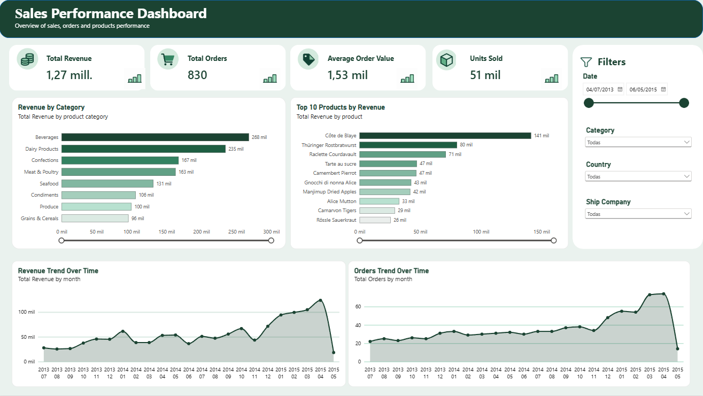
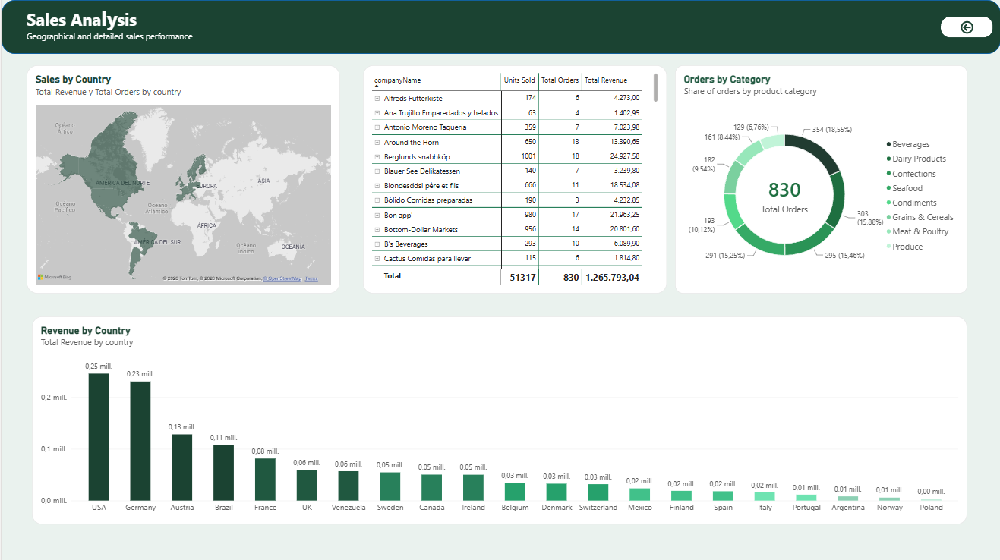

# Sales Performance Dashboard

## 1. Descripción del proyecto

Este proyecto consiste en el análisis de ventas de una empresa mediante un dashboard interactivo desarrollado en **Microsoft Power BI**.

El objetivo es comprender qué categorías de productos, productos individuales y mercados geográficos generan más ingresos, cómo evolucionan las ventas a lo largo del tiempo y cómo se distribuyen los pedidos entre los clientes y las empresas de transporte.

### Pregunta de negocio

**¿Qué productos, categorías y mercados contribuyen más a los ingresos de la empresa y qué oportunidades de mejora pueden identificarse a partir de los datos?**

El dashboard permite explorar los principales indicadores de rendimiento, comparar resultados y analizar la información mediante filtros interactivos.

## 2. Herramientas utilizadas

- **Microsoft Power BI:** creación del dashboard, visualizaciones e interactividad.
- **Power Query:** limpieza, transformación y preparación de los datos.
- **DAX (Data Analysis Expressions):** creación de medidas para calcular los indicadores clave de rendimiento (KPI).
- **Modelo de datos relacional:** conexión de las tablas y análisis de información procedente de distintas fuentes.
- **GitHub:** documentación y publicación del proyecto para el portfolio profesional.

## 3. Datos utilizados

El proyecto utiliza datos de ventas estructurados en varias tablas relacionadas.

### Tablas principales

- **fact_orders:** información de los pedidos, incluyendo fechas, clientes, empleados, transportistas y gastos de envío.
- **tabl_order_details:** detalle de cada pedido, con identificadores de productos, cantidades, precios unitarios y descuentos.
- **dim_products:** información de los productos, sus precios, categorías y disponibilidad.
- **dim_categories:** nombres y descripciones de las categorías de productos.
- **dim_customers:** información de los clientes, empresas, ciudades y países.
- **dim_employees:** información de los empleados responsables de los pedidos.
- **dim_shippers:** información de las empresas de transporte.
- **dim_Date:** calendario con atributos temporales para analizar la evolución de las ventas.

### Preparación de los datos

Durante la preparación de los datos se trabajó en:

- La revisión de los tipos de datos.
- La conversión de precios y descuentos a formatos numéricos correctos.
- La comprobación de las relaciones entre las tablas.
- La creación de medidas DAX para calcular los indicadores principales.
- La preparación de los campos necesarios para las visualizaciones y los filtros.

El periodo analizado en el dashboard abarca de julio de 2013 a mayo de 2015.

## 4. Modelo de datos

El modelo relaciona los pedidos con sus líneas de detalle y conecta esta información con las dimensiones de productos, categorías, clientes, empleados, transportistas y calendario.

Las relaciones permiten analizar las ventas desde distintas perspectivas sin perder la relación entre los pedidos y sus productos.

Se presta especial atención a la dirección de filtrado y a la cardinalidad de las relaciones, ya que son fundamentales para que los filtros interactivos y las medidas DAX funcionen correctamente.

## 5. Indicadores clave de rendimiento (KPI)

El dashboard incluye cuatro indicadores principales:

- **Total Revenue:** ingresos totales después de aplicar los descuentos.
- **Total Orders:** número de pedidos únicos.
- **Average Order Value:** valor medio de un pedido.
- **Units Sold:** cantidad total de unidades vendidas.

### Medidas DAX

**Total Revenue**

Calcula los ingresos considerando el precio unitario, la cantidad vendida y el descuento aplicado.

```dax
Total Revenue =
SUMX(
    tabl_order_details,
    tabl_order_details[unitPrice]
        * tabl_order_details[quantity]
        * (1 - tabl_order_details[discount])
)
```

**Total Orders**

Cuenta cada pedido una sola vez.

```dax
Total Orders =
DISTINCTCOUNT(fact_orders[orderID])
```

**Average Order Value**

Calcula el valor medio de los pedidos.

```dax
Average Order Value =
DIVIDE(
    [Total Revenue],
    [Total Orders],
    0
)
```

**Units Sold**

Calcula el número total de unidades vendidas.

```dax
Units Sold =
SUM(tabl_order_details[quantity])
```

## 6. Dashboard e informes

El proyecto contiene dos páginas principales que permiten analizar el rendimiento comercial desde perspectivas complementarias.

### Página 1 — Sales Performance Dashboard



Esta página ofrece una visión general del rendimiento de las ventas.

Incluye:

- **KPI cards:** ingresos totales, número de pedidos, valor medio por pedido y unidades vendidas.
- **Revenue by Category:** comparación de los ingresos generados por cada categoría de productos.
- **Top 10 Products by Revenue:** identificación de los productos con mayor contribución a los ingresos.
- **Filtros interactivos:** periodo de fechas, categoría, país y empresa de transporte.

Los filtros permiten explorar los resultados según diferentes criterios y comprobar cómo cambian los indicadores y las visualizaciones al seleccionar distintos valores.

### Página 2 — Sales Analysis



Esta página profundiza en el análisis geográfico y en el detalle de las ventas.

Incluye:

- **Sales by Country:** visualización geográfica de la actividad comercial.
- **Revenue by Country:** comparación de los ingresos entre países.
- **Tabla de detalle:** análisis por cliente y producto, con unidades vendidas, pedidos e ingresos.
- **Análisis por transportista:** comparación de la actividad de las empresas de transporte.

La tabla permite pasar de una visión general a un nivel de detalle más específico, facilitando la exploración de los resultados por cliente y producto.

## 7. Principales insights

A partir de las visualizaciones del dashboard se pueden identificar las siguientes observaciones:

- **Diferencias entre mercados:** Estados Unidos y Alemania destacan entre los países con mayores ingresos en la visualización geográfica y la comparación por país.
- **Importancia de las categorías:** los ingresos varían entre las categorías de productos, lo que permite identificar cuáles contribuyen más a las ventas.
- **Concentración de ingresos en productos:** la clasificación de los diez productos principales permite identificar los artículos que generan una parte importante de los ingresos.
- **Diferentes niveles de actividad por cliente:** la tabla de detalle permite comparar clientes según el número de pedidos, las unidades vendidas y los ingresos generados.
- **Análisis temporal:** el filtro de fechas facilita estudiar la evolución de las ventas y comparar distintos periodos.

Estas observaciones describen patrones visibles en el dashboard. Para cuantificar porcentajes de contribución, crecimiento o estacionalidad, es necesario realizar cálculos específicos adicionales.

## 8. Recomendaciones de negocio

A partir de los análisis realizados, se proponen las siguientes líneas de actuación:

- **Optimizar la estrategia por mercado:** estudiar las características de los países con mayores ingresos e identificar oportunidades para desarrollar las ventas en otros mercados.
- **Revisar el rendimiento de las categorías:** comparar los ingresos y las unidades vendidas para comprender qué categorías tienen mayor peso comercial.
- **Analizar los productos líderes:** evaluar la disponibilidad de los productos con mayores ingresos y estudiar su evolución a lo largo del tiempo.
- **Mejorar la gestión de clientes:** identificar los clientes con mayor contribución a los ingresos y explorar oportunidades para aumentar su actividad.
- **Evaluar el rendimiento logístico:** comparar los pedidos gestionados por cada transportista para detectar posibles diferencias en la distribución de la actividad.

Estas recomendaciones son propuestas iniciales basadas en el análisis descriptivo. Antes de tomar decisiones, conviene contrastarlas con indicadores adicionales y con información operativa del negocio.

## 9. Competencias demostradas

Este proyecto demuestra experiencia práctica en:

- Preparación y transformación de datos con Power Query.
- Creación de medidas DAX para indicadores de negocio.
- Diseño y revisión de un modelo de datos relacional.
- Construcción de dashboards interactivos en Power BI.
- Análisis de ventas por producto, categoría, cliente, país y periodo.
- Diseño de visualizaciones orientadas a facilitar la interpretación de los datos.
- Documentación de proyectos analíticos en GitHub.

## 10. Conclusión

El proyecto transforma datos de pedidos y ventas en un dashboard interactivo que facilita la comprensión del rendimiento comercial.

La combinación de indicadores KPI, visualizaciones geográficas, análisis por categorías y productos, tablas de detalle y filtros interactivos permite explorar los datos desde diferentes perspectivas y obtener información útil para la toma de decisiones.

Este trabajo forma parte de mi portfolio de análisis de datos y refleja la aplicación práctica de Power BI, Power Query, DAX y el modelado de datos en un caso de análisis comercial.
